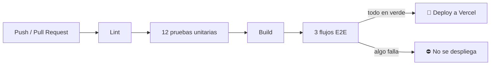

<div align="center">

# 🛒 OmniMarket Operations Hub

**Panel de operaciones para e-commerce:** ventas en tiempo real, pedidos, productos y un tablero Kanban con arrastrar y soltar.

[](https://github.com/rigoberto-s/omnimarket-hub/actions/workflows/ci.yml)
[](https://omnimarket-hub-one.vercel.app)


### [🌐 Abrir la aplicación](https://omnimarket-hub-one.vercel.app) · [📦 Repositorio](https://github.com/rigoberto-s/omnimarket-hub) · [⚙️ Pipeline CI](https://github.com/rigoberto-s/omnimarket-hub/actions)

</div>

---

## 📋 Contenido

- [Endpoints de auditoría](#-endpoints-de-auditoría-apitest)
- [Funcionalidades](#-funcionalidades)
- [Tecnologías](#-tecnologías)
- [Pruebas](#-pruebas)
- [CI/CD](#-cicd)
- [Correrlo en local](#-correrlo-en-local)
- [Equipo](#-equipo)

---

## 🔍 Endpoints de auditoría (`/api/test/*`)

> [!IMPORTANT]
> Estos endpoints son **públicos a propósito**, por requisito de la rúbrica: el evaluador puede llamarlos **sin iniciar sesión**. Trabajan solo con el conjunto de datos de prueba.

| Método | Ruta | Qué hace | Probar |
|:---:|---|---|:---:|
|  | `/api/test/analytics?page=1&limit=50` | KPIs, ventas por día (últimos 30 días) y pedidos paginados, más recientes primero. Incluye `elapsedMs`. | [▶️](https://omnimarket-hub-one.vercel.app/api/test/analytics?page=1&limit=50) |
|  | `/api/test/reset-data` | Restaura los datos de prueba: **20 productos y 300 pedidos**. El pedido `id = 1` queda siempre en `pending`. | — |
|  | `/api/test/kanban-status?orderId=1` | Estado actual de un pedido: `{ orderId, status, updatedAt }`. Sin `orderId` devuelve el conteo por estado. | [▶️](https://omnimarket-hub-one.vercel.app/api/test/kanban-status?orderId=1) |

```bash
# Analítica y tiempo de respuesta
curl -s -o /dev/null -w "%{http_code} %{time_total}s\n" \
  "https://omnimarket-hub-one.vercel.app/api/test/analytics?page=1&limit=50"

# Restaurar los datos de prueba
curl -s -X POST https://omnimarket-hub-one.vercel.app/api/test/reset-data

# Estado de un pedido (por ejemplo, después de moverlo en el Kanban)
curl -s "https://omnimarket-hub-one.vercel.app/api/test/kanban-status?orderId=1"
```

> [!NOTE]
> El campo `elapsedMs` mide el tiempo del **backend** (consultas a la base de datos). En producción se mantiene entre **5 y 30 ms**, muy por debajo del límite de **300 ms**. Las consultas corren en paralelo, se agregan en SQL y la función de Vercel está en la misma región que la base de datos (`iad1`, Virginia).

Parámetros inválidos (por ejemplo `limit=500`) responden `400` con `{ "error", "issues" }`. Todos los montos viajan en **centavos** (enteros).

---

## ✨ Funcionalidades

| | Módulo | Detalle |
|:---:|---|---|
| 🔐 | **Inicio de sesión** | OAuth 2.0 con **Google** y **GitHub** (Auth.js). Las páginas y la API privada exigen sesión. |
| 📊 | **Dashboard** | Ventas totales, número de pedidos, ticket promedio, margen bruto y gráfica de ventas por día. |
| 📦 | **Pedidos** | Tabla con filtros por estado y cliente, creación de pedidos y **edición en lote** del estado. |
| 🗂️ | **Kanban** | Columnas `pending` → `preparing` → `shipped` → `delivered` con **arrastrar y soltar**. |
| 🏷️ | **Productos** | Alta, edición y borrado (no se puede borrar un producto con pedidos). |
| ⚡ | **Experiencia** | Cargas con *Skeletons* (sin spinners) y avisos con *Toasts*. |

> [!TIP]
> El Kanban y la edición en lote son **optimistas**: el cambio se ve al instante y, si el servidor falla, se revierte solo y aparece un aviso de error.

---

## 🧰 Tecnologías

| Capa | Tecnología |
|---|---|
| Framework | Next.js 16 (App Router), React 19, TypeScript |
| Estilos y UI | Tailwind CSS 4, shadcn/ui, Recharts, Sonner |
| Datos en el cliente | TanStack Query, dnd-kit |
| Base de datos | PostgreSQL en Neon, Drizzle ORM |
| Autenticación | Auth.js v5 (Google y GitHub), sesión JWT |
| Validación | Zod (esquemas compartidos entre API y formularios) |
| Pruebas | Vitest (unitarias), Playwright (E2E) |
| CI/CD y hosting | GitHub Actions, Vercel |

---

## 🧪 Pruebas

| Tipo | Cantidad | Qué cubren |
|---|:---:|---|
| ✅ **Unitarias** (Vitest) | **12** | Ticket promedio y margen bruto, formato de moneda, esquemas Zod, filtros y paginación. |
| ✅ **E2E** (Playwright) | **3 flujos** | **Autenticación** (redirección de rutas privadas y sesión), **creación** de un pedido que aparece en la tabla y **drag & drop** de una tarjeta del Kanban con persistencia. |

```bash
npm run test:unit   # pruebas unitarias
npm run test:e2e    # flujos E2E
```

> [!WARNING]
> Las E2E llaman a `POST /api/test/reset-data` antes de cada prueba, así que **borran y recrean los datos**. Córrelas solo contra una base de desarrollo, nunca contra la de producción. Antes de la primera ejecución: `npx playwright install chromium`.

---

## 🚀 CI/CD

Cada Pull Request y cada push a `main` pasan por GitHub Actions ([`.github/workflows/ci.yml`](.github/workflows/ci.yml)). **Solo se despliega a producción si todas las pruebas pasan**; Vercel no despliega por su cuenta (`vercel.json`).



El job de pruebas levanta su propio PostgreSQL, así que nunca toca la base de producción.

---

## 💻 Correrlo en local

<details>
<summary><b>Instalación paso a paso</b> (clic para abrir)</summary>

<br>

**Requisitos:** Node.js **22.13 o superior** y una base PostgreSQL (usamos Neon).

```bash
git clone https://github.com/rigoberto-s/omnimarket-hub.git
cd omnimarket-hub
npm ci
cp .env.example .env.local   # y completa los valores
npm run db:push              # crea las tablas
npm run db:seed              # carga 20 productos y 300 pedidos
npm run dev                  # http://localhost:3000
```

</details>

<details>
<summary><b>Variables de entorno</b> (clic para abrir)</summary>

<br>

| Variable | Para qué sirve |
|---|---|
| `DATABASE_URL` | Cadena de conexión de PostgreSQL. En Neon, usar la *pooled* (host con `-pooler`) y `?sslmode=require`. |
| `AUTH_SECRET` | Firma las sesiones. Generar con `npx auth secret` o `openssl rand -base64 32`. |
| `AUTH_GOOGLE_ID`, `AUTH_GOOGLE_SECRET` | Credenciales OAuth de Google. |
| `AUTH_GITHUB_ID`, `AUTH_GITHUB_SECRET` | Credenciales OAuth de GitHub. |
| `ENABLE_TEST_LOGIN` | `true` habilita el acceso de prueba que usan las E2E. **Nunca** activarlo en producción. |
| `NEXT_PUBLIC_USE_MOCKS` | Opcional. `true` hace que el frontend use datos de ejemplo en lugar de la API. |

`.env.local` nunca se sube a Git; `.env.example` sí, sin valores.

</details>

<details>
<summary><b>Scripts disponibles</b> (clic para abrir)</summary>

<br>

| Script | Qué hace |
|---|---|
| `npm run dev` | Servidor de desarrollo |
| `npm run build` / `npm start` | Build y servidor de producción |
| `npm run lint` | ESLint |
| `npm run db:push` | Crea o actualiza las tablas según `src/db/schema.ts` |
| `npm run db:seed` | Borra y recrea los datos de prueba |
| `npm run test:unit` / `npm run test:e2e` | Pruebas unitarias / E2E |

</details>

<details>
<summary><b>Estructura del proyecto</b> (clic para abrir)</summary>

<br>

```
src/
  app/
    (app)/            dashboard, orders, kanban, products (requieren sesión)
    login/            pantalla de inicio de sesión
    api/              analytics, orders, products, auth, test/*
  components/         UI (shadcn/ui), layout, dashboard, pedidos, productos, kanban
  db/                 esquema Drizzle, conexión y seed
  hooks/              hooks de TanStack Query
  lib/                schemas (Zod), metrics, format, services, api, types
  mocks/              datos de ejemplo para el frontend
scripts/seed.ts       carga los datos de prueba
tests/unit, tests/e2e
```

</details>

---

## 👥 Equipo

| Integrante | Rol | Responsabilidades |
|---|---|---|
| **Rigoberto Sánchez** | Backend A | Base de datos, seed, núcleo compartido, endpoints de analítica y auditoría, pruebas unitarias y despliegue |
| **Alejandro** | Backend B | Autenticación, API de pedidos y productos, pruebas E2E y CI |
| **Ricardo** | Frontend | Interfaz: dashboard, pedidos, Kanban y productos |
